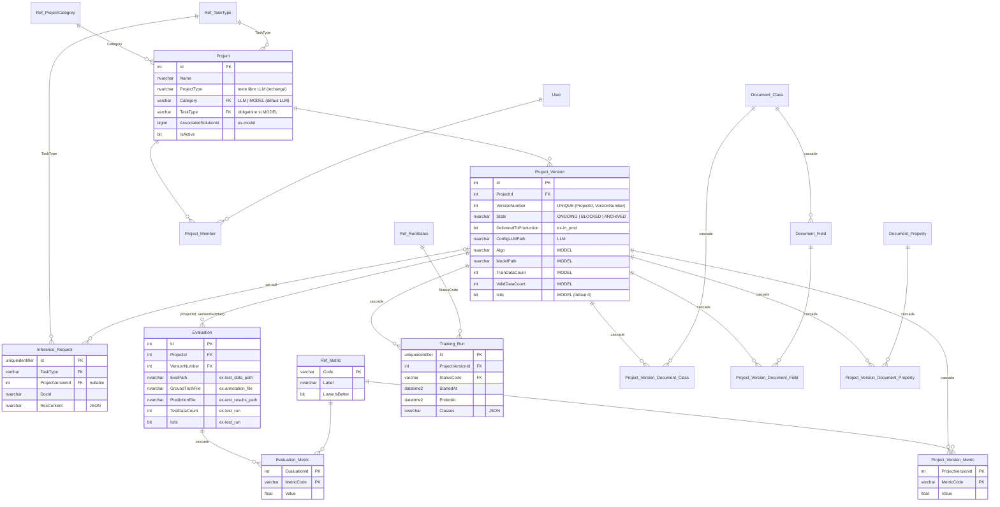

# Architecture de la base fusionnée — projets LLM et modèles entraînés

La base SQL Server existante (projets **LLM** : `Project`, `Project_Version`,
`Evaluation`…) accueille désormais les **modèles entraînés** issus du schéma
restructuré (`../schema.sql`, rédigé pour PostgreSQL). Les deux familles de
projets coexistent dans les mêmes tables :

| Concept | LLM (existant) | Modèle entraîné (ex-schéma ML) | Table commune |
|---|---|---|---|
| Projet | projet LLM | `model` | `Project` (`Category` = `LLM` / `MODEL`) |
| Version | version LLM | `model_version` | `Project_Version` |
| Évaluation | évaluation LLM | `test_run` | `Evaluation` |

Les scripts sont dans `1_tables/` (préfixe `00_` à `18_`). Les ajouts sont
signalés dans le code par `[FUSION ML]`.

---

## 1. Revue du schéma restructuré (PostgreSQL)

**Sur le fond, le schéma est pertinent.** Il remplace les 28 tables recopiées par
type de modèle par 13 tables, grâce à un discriminateur de type et à des
métriques stockées en lignes. Il ajoute aussi de vraies clés étrangères et des
règles d'unicité.

**Il n'était en revanche ni optimal ni utilisable tel quel.** Les problèmes
relevés, et leur correction dans la version SQL Server :

| # | Problème | Correction |
|---|---|---|
| 1 | `ENUM` (`model_type`, `run_status`, `metric_scope`) : n'existe pas en SQL Server | Tables de référence `Ref_TaskType`, `Ref_RunStatus`, `Ref_ProjectCategory` + clés étrangères. Ajouter une valeur ne demande aucun changement de schéma, et un libellé est disponible pour l'IHM. `metric_scope` disparaît (voir #2). |
| 2 | Table `metric` : `scope` est redondant avec `test_run_id` (la contrainte CHECK impose l'équivalence) ; `model_version_id` et `test_run_id` peuvent désigner des versions différentes ; `name` est en texte libre (`f1` / `F1` / `f1_score`) | Deux tables étroites : `Project_Version_Metric` (validation) et `Evaluation_Metric` (test). Leur clé primaire interdit les doublons, ce qui supprime les index uniques filtrés. Les noms de métriques sont contrôlés par `Ref_Metric`, qui indique aussi le sens d'optimisation (`LowerIsBetter`). |
| 3 | `test_run` recrée un concept qui existe déjà : `Evaluation` | `test_run` est fusionné dans `Evaluation` (une version testée sur un jeu de données annoté). Les évaluations LLM peuvent ainsi, elles aussi, porter des métriques. |
| 4 | `in_prod` fait double emploi avec `DeliveredToProduction`. Le brouillon `schema fusionne.sql` utilisait `state = 'production'`, une valeur qui n'existe pas : `State` vaut `ONGOING` / `BLOCKED` / `ARCHIVED` | `in_prod` → `DeliveredToProduction` (existant). |
| 5 | Index unique filtré « une seule version en prod » | Incompatible avec le trigger existant : l'`UPDATE` qui flague la nouvelle version échouerait avant que le trigger ne déflague l'ancienne. La règle reste portée par `trg_ProjectVersion_Update`. |
| 6 | `project_type` retypé en `ENUM` | Cette colonne contient le texte libre des projets LLM, qui serait perdu. Elle est conservée telle quelle ; on ajoute `Category` (LLM / MODEL) et `TaskType` (ex-`model_type`). |
| 7 | `TEXT` partout | Types bornés (`nvarchar(50/100/200)`, `varchar(n)` pour les codes) là où on indexe, compare ou impose l'unicité ; `nvarchar(max)` réservé aux textes libres et aux chemins. |
| 8 | Clés `BIGINT` | Les FK doivent avoir le même type que la clé visée : `int`, comme `Project` et `Project_Version`. `uniqueidentifier` pour `Training_Run` et `Inference_Request` (voir section 2.1). |
| 9 | `ON DELETE CASCADE` partout | Cascade seulement pour les données possédées par la version (métriques, entraînements, associations). `SET NULL` pour les inférences, qui gardent leur trace. Aucune action pour les évaluations : pas de suppression silencieuse de résultats. |
| 10 | Clés étrangères non indexées (SQL Server ne le fait pas automatiquement) | Index explicites sur toutes les colonnes de FK et sur les colonnes de recherche (`DocId`, `TaskType + CreatedAt`). |
| 11 | `JSONB` | `nvarchar(max)` + contrainte `ISJSON`. |
| 12 | Le brouillon fusionné retirait `epoch` et `classes` au profit d'un `config_path` qui n'existe nulle part | `Epoch` et `Classes` sont rétablis (comme dans `schema.sql`). |
| 13 | `UNIQUE (name, model_type)` | Non reproductible : `Project.Name` est en `nvarchar(max)`, qui ne peut pas être indexé. Voir les recommandations. |

---

## 2. Modèle fusionné



`Team`, `User`, `Project_History` et `Project_Member` ne changent pas. Les
triggers d'historique tracent automatiquement les nouvelles colonnes, car ils
sérialisent la ligne entière en JSON. `Document_Request` est une table
indépendante.

### 2.1 Identifiants : `int` ou `uniqueidentifier` (GUID) ?

Un GUID est pertinent quand l'identifiant est généré ou utilisé **hors de la
base** : connu avant l'insertion, partagé avec un autre système, exposé à un
client, ou fusionné depuis plusieurs sources. Dans les autres cas, un `int`
est plus compact (4 octets contre 16, dans chaque index et chaque clé
étrangère), plus lisible, et ne fragmente pas l'index cluster.

| Table | Clé | Justification |
|---|---|---|
| `Training_Run` | **GUID** | Identifiant partagé avec le pipeline d'entraînement (dossiers de sortie, logs), qui peut le générer avant l'insertion. |
| `Inference_Request` | **GUID** | Identifiant de corrélation avec le service d'inférence, renvoyé au client (non devinable). Table de traces, comme `Project_History`, déjà en GUID. |
| `Project_History` | GUID (existant) | Inchangé. |
| `Team`, `User`, `Project`, `Project_Version`, `Evaluation` | `int` (existant) | Passer en GUID casserait le contrat avec l'application existante (identifiants dans l'API et le code), ainsi que les triggers (`Project_History.EntityId`, `UpdatedBy` et `DeleterId` en `int`) et la procédure. Il faudrait aussi réécrire toutes les FK et migrer les données, pour aucun gain : ces identifiants sont générés et utilisés uniquement par la base. |
| `Document_Class`, `Document_Field`, `Document_Property`, `Document_Request` | `int` | Référentiel interne, très joint, sans génération externe. Cohérent avec `Project`. |
| `Ref_*` | code `varchar` | Clé naturelle lisible (`'DETECTION'`, `'F1'`). |
| Métriques, associations | clé composite | Pas d'identifiant technique : la paire de clés étrangères est la clé. |

Les GUID ont pour défaut `NEWSEQUENTIALID()` : les valeurs générées par la base
sont croissantes, ce qui évite la fragmentation de l'index cluster. Un GUID
fourni par l'application (`NEWID()`, `Guid.NewGuid()`) est aléatoire : sur
`Inference_Request`, à forte volumétrie, mieux vaut laisser la base le générer
(et le récupérer avec `OUTPUT inserted.Id`).

### Tables ajoutées

| Script | Table | Remplace |
|---|---|---|
| `00_Ref_*` | `Ref_ProjectCategory`, `Ref_TaskType`, `Ref_RunStatus`, `Ref_Metric` | les `ENUM` et les noms de métriques en texte libre |
| `08` | `Project_Version_Metric` | colonnes de métriques des 5 tables `Model*_Version` |
| `09` | `Evaluation_Metric` | colonnes de métriques des 5 tables `Model*_Version_Test` |
| `10` | `Training_Run` | `TrainTrack`, `SegmentationTrainTrack`, `DetectionTrainTrack`, `ExtractionTrainTrack` |
| `11` | `Inference_Request` | `Classification_Test`, `Segmentation_Test`, `Detection_Test`, `Extraction_Test`, `Decoupage_Test` |
| `12`–`14` | `Document_Class`, `Document_Field`, `Document_Property` | `DocumentClass`, `DocumentField`, `DocumentProperty` |
| `15`–`17` | `Project_Version_Document_Class/Field/Property` | `DocumentClassProjects`, `DocumentFieldProjects`, `DocumentPropertyProjects` |
| `18` | `Document_Request` | `DocumentRequest` |

Les données de référence (`Ref_*`) sont insérées par leur script de table, et
non dans `3_init` : les contraintes des tables suivantes en dépendent dès la
phase `1_tables`. Le script est la référence des libellés : il les réaligne à
chaque exécution.

---

## 3. Correspondance des colonnes ML

| Ancien (schéma ML) | Nouveau |
|---|---|
| `model.name` / `project_type` / `created_by` / `created_at` | `Project.Name` / `ProjectType` / `CreatedBy` / `CreatedAt` |
| `model.model_type` | `Project.TaskType` (+ `Category = 'MODEL'`) |
| `model.associated_solution_id` | `Project.AssociatedSolutionId` |
| `model_version.version_nb` | `Project_Version.VersionNumber` |
| `model_version.comment` | `Project_Version.Description` |
| `model_version.in_prod` | `Project_Version.DeliveredToProduction` |
| `model_version.algo`, `model_path`, `annotation_file`, `train_data_path`, `train_data_count`, `valid_data_count`, `is_itc` | `Project_Version.Algo`, `ModelPath`, `AnnotationFile`, `TrainDataPath`, `TrainDataCount`, `ValidDataCount`, `IsItc` |
| `test_run.model_version_id` | `Evaluation.(ProjectId, VersionNumber)` |
| `test_run.test_data_path` / `annotation_file` / `test_results_path` | `Evaluation.EvalPath` / `GroundTruthFile` / `PredictionFile` |
| `test_run.created_by` / `created_at` | `Evaluation.TriggeredBy` / `Timestamp` |
| `test_run.test_data_count`, `is_itc`, `comment` | `Evaluation.TestDataCount`, `IsItc`, `Comment` |
| `metric` (scope `validation`) | `Project_Version_Metric` |
| `metric` (scope `test`) | `Evaluation_Metric` |
| `Accuracy`, `ErrorRate`, `PrecisionScore`, `RecallScore`, `f1_score`, `kappa`, `AP_bbox`, `Recall_bbox`, `AP_segm`, `Recall_segm`, `MeanErrors`, `NbErrors` | `Ref_Metric.Code` : `ACCURACY`, `ERROR_RATE`, `PRECISION`, `RECALL`, `F1`, `KAPPA`, `AP_BBOX`, `RECALL_BBOX`, `AP_SEGM`, `RECALL_SEGM`, `MEAN_ERRORS`, `NB_ERRORS` |

Exemple : meilleure version d'un projet sur une métrique, quel que soit son sens
d'optimisation.

```sql
SELECT TOP (1) pv.VersionNumber, m.Value
FROM dbo.Project_Version_Metric m
JOIN dbo.Project_Version pv ON pv.Id = m.ProjectVersionId
JOIN dbo.Ref_Metric r       ON r.Code = m.MetricCode
WHERE pv.ProjectId = @ProjectId AND m.MetricCode = 'AP_BBOX'
ORDER BY CASE WHEN r.LowerIsBetter = 1 THEN m.Value ELSE -m.Value END;
```

---

## 4. Impacts sur l'existant

| Changement | Effet |
|---|---|
| `Project.Category` NOT NULL, défaut `'LLM'` | Les projets existants et les insertions de l'application actuelle (qui ne connaît pas la colonne) restent des projets LLM. Rien à modifier côté application. |
| `GetListProjectWithVersion` : nouveau paramètre `@Category` (défaut `'LLM'`) | Un appel existant (`@PersoId` seul) renvoie la même liste qu'avant, sans les modèles. Le résultat a **2 colonnes de plus** (`Category`, `TaskType`) : à vérifier si l'application lit les colonnes par position. |
| `UQ_Project_Version_ProjectId_VersionNumber` | Un même numéro de version ne peut plus exister deux fois dans un projet. Si des doublons existent, le script ne crée pas la contrainte et affiche un avertissement avec la requête pour les lister. |
| `FK_Evaluation_ProjectVersion` (composite, `ON UPDATE CASCADE`) | Une évaluation doit viser une version existante. **Supprimer une version qui a des évaluations est désormais refusé** : l'application doit d'abord supprimer ces évaluations. Jusqu'ici, elles restaient orphelines. En cas d'orphelins existants, le script ne crée pas la FK et affiche un avertissement. |
| Colonnes `bit` ajoutées (`IsItc`, `LowerIsBetter`) | Défaut à 0. |

---

## 5. Points ouverts et recommandations

1. **Migration des données ML historiques.** Les scripts créent la structure.
   Reprendre les données des 28 anciennes tables demande leur DDL, qui n'est pas
   dans ce dépôt. La correspondance de la section 3 sert de spécification.
   Attention : les identifiants des 5 tables de versions se chevauchent. Il faut
   donc une table de correspondance `(table source, ancien Id) → Project_Version.Id`.
2. **`ProjectType` et `TaskType`.** Si les valeurs de `ProjectType` des projets
   LLM correspondent à des types de tâche, les deux colonnes peuvent être
   fusionnées dans `TaskType`. À vérifier avec
   `SELECT ProjectType, COUNT(*) FROM dbo.Project GROUP BY ProjectType;`.
3. **Règles non portées par la base.** `Training_Run` et les colonnes ML de
   `Project_Version` n'ont de sens que pour un projet `MODEL`. Ce n'est pas
   vérifié en base, car il faudrait un trigger : c'est à la couche applicative
   de le garantir.
4. **Existant :**
   - `User.TeamId` n'a pas de clé étrangère vers `Team`.
   - `Project.Name` et les colonnes d'audit sont en `nvarchar(max)`, ce qui empêche
     tout index ou contrainte d'unicité. Les nouvelles tables utilisent
     `nvarchar(50)` pour l'audit.
5. **`Document_Request.Type` et `Status`** restent en texte libre tant que leurs
   valeurs historiques ne sont pas connues. Ensuite, une table `Ref_` pourra les
   remplacer.
6. **Les fichiers PostgreSQL** (`../schema.sql`, `../schema fusionne.sql`,
   `../schema.mmd`) ne correspondent plus à la cible. Ils sont conservés comme
   historique de conception.
